*A gpt-oss-120b case study in profiling, performance bounds, HIP graph capture, and W4A8 MoE tuning.*

> [!NOTE]
> **Why gpt-oss-120b?** This post is a systems case study, not a model recommendation. We use gpt-oss-120b because one workload exposes several common inference bottlenecks at once: low-intensity decode GEMMs, high-intensity prefill GEMMs, many small tensor-parallel collectives, shape-dependent graph capture, and short-K scaling at higher tensor parallelism. The method is meant to transfer to other models and accelerators.

## TL;DR

A TP8 `rocprof` trace suggested that QuickReduce was taking about half of the prefill time. This made all-reduce look like the main bottleneck.

Before changing the collective, we checked how long the data transfer should take. The all-reduce moved about 39 MB of estimated wire traffic, which should take roughly 0.16-0.26 ms at the measured bandwidth. However, the trace showed a 7.81 ms delay between ranks. Most of that time was therefore spent waiting, not transferring data.

Repeated runs confirmed that the problem was outside GPU computation. GPU compute time varied by less than 0.7%, but throughput dropped from 53.3 to 42.9 requests/s. Incomplete HIP graph capture and CPU contention created GPU idle bubbles lasting 130-160 ms.

We replaced unstable kernel paths with AITER kernels and captured more serving shapes in HIP graphs. This removed the large host stalls. After re-profiling, the main GPU bottleneck was the W4A8 grouped MoE GEMM. Roofline analysis showed that decode was limited mainly by HBM bandwidth, while prefill had more room to improve compute efficiency.

Across the matched benchmark cells, the complete set of changes improved geometric-mean throughput by 1.63x for decode-heavy traffic and 1.53x for prefill-heavy traffic. The best individual cells improved by 2.3-2.4x.

The main lesson is a workflow that developers can reuse:

> **Profile -> Establish a performance bound -> Identify the unexplained gap -> Verify the cause -> Fix -> Re-profile**

---

## Why this workload is useful

A plausible first explanation can still point to the wrong bottleneck.

A profiler can accurately report that a GPU spent time inside an all-reduce range. It cannot, by itself, tell us whether that time was spent moving bytes, waiting for another rank, waiting for the host to submit work, or absorbing delay created earlier in the execution path. Attribution is not causality.

[`gpt-oss-120b`](https://openai.com/index/introducing-gpt-oss/) shows this distinction clearly. The model has 36 layers, 128 experts, and activates four experts per token. The AMD checkpoint used here stores MoE weights in MXFP4 and uses FP8 activations, which we refer to as W4A8. In serving, this creates two different operating regimes:

- **Decode:** Each expert receives few tokens. Large expert weights are streamed from HBM with little reuse, so arithmetic intensity is low and the expert GEMM is memory-bandwidth-bound.
- **Prefill:** Many tokens reuse each weight tile. Arithmetic intensity rises, and the same expert GEMM can become compute-bound.
- **Tensor parallelism:** Each layer also contains blocking collectives. Decode executes about 73 small all-reduces per token step, making synchronization latency visible even when the payload is tiny.
- **Higher TP:** Sharding reduces the per-GPU contraction dimension. That can make GEMMs less efficient, increase padding overhead, and change which memory layout wins.

A single trace therefore exposes host scheduling, collectives, memory bandwidth, matrix throughput, padding, and kernel dispatch.

The analysis is also useful to readers who do not have an eight-GPU MI355X node. Reproducing the final throughput number requires the hardware, but following the reasoning does not. A trace excerpt, a few payload calculations, the Roofline script, and per-rank timing data are enough to follow the diagnosis and apply the same process elsewhere.

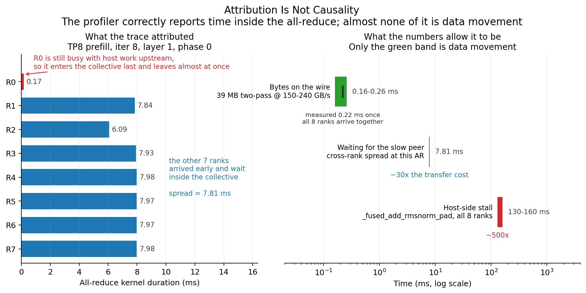

*The profiler correctly shows that these ranks spend about 8 ms inside the all-reduce. The left panel shows one measured all-reduce site (TP8 prefill, iteration 8, layer 1, phase 0, stock-Triton baseline). Seven ranks arrive early and block, while rank 0 finishes upstream host work and passes through in 0.17 ms. The right panel compares that duration with three possible explanations. Only the green band represents data movement, and it is roughly two orders of magnitude smaller than the other two. The panel combines three types of data. The wire band is an analytic bound for 39 MB of two-pass BF16 traffic at 150-240 GB/s effective, plus one 0.22 ms measurement taken after all eight ranks arrived. The blue band is the measured cross-rank spread at this site. The red band is the separately observed `_fused_add_rmsnorm_pad` host stall, which affects all eight ranks instead of staggering them. The stalled rank and iteration vary across runs, but the host stall does not.*

The generation script and its input data are included with the article: [`make_hero_attribution.py`](/assets/figures/2026-11-02-when-the-trace-blamed-all-reduce/make_hero_attribution.py) and [`iter8_l1p0_per_rank_ar.csv`](/assets/figures/2026-11-02-when-the-trace-blamed-all-reduce/iter8_l1p0_per_rank_ar.csv).

---

## Experimental setup and evidence boundaries

We used one eight-GPU [AMD Instinct MI355X](https://www.amd.com/en/products/accelerators/instinct/mi350/mi355x.html) node. Each MI355X provides 288 GB of HBM3E and a specified peak memory bandwidth of 8 TB/s. The model was served with vLLM and AMD's AITER kernels.

| Item | Configuration |
|---|---|
| Model | `amd/gpt-oss-120b-w-mxfp4-a-fp8` |
| Quantization | MXFP4 weights, FP8 activations (W4A8) |
| Accelerator | 8x AMD Instinct MI355X, CDNA4 |
| Serving stack | vLLM 0.23.1-dev, AITER 0.1.16, Triton 3.6.0 |
| Container | `vllm/vllm-openai-rocm:nightly-34b560b725b401f33477464163244b4744d1c40f` |
| Tensor parallelism | TP1, TP2, TP4, TP8 |
| Concurrency | 4 through 256 |
| Request shapes | 1K input / 1K output and 8K input / 1K output |
| Sweep size | 56 matched cells |
| Cache policy | Cold cache at the start of each run; prefix caching disabled |
| Profiling | Full `rocprof` traces at TP4 and TP8, including per-rank GPU and host timelines |
| Primary metrics | Output throughput, TTFT, TPOT, kernel time, host gaps, and cross-rank spread |

The main results compare MI355X before and after the software changes using the same serving harness and matched cells. This comparison directly measures the impact of the changes.

We report cross-platform B200 numbers only in the appendix and treat them as a dated software snapshot, not as a general statement about either platform. Cross-vendor results are especially sensitive to framework version, kernel selection, host configuration, and benchmark date.

---

## A bound-driven optimization workflow

We used three different models because different bottlenecks obey different limits.

### 1. Compute and HBM Roofline for GPU kernels

For a kernel with arithmetic intensity $AI$ in FLOP/byte, the first-order performance ceiling is

$$
P_{max} = \min(P_{compute}, AI \times BW_{HBM}).
$$

This model is useful for GEMMs, normalization, and elementwise kernels. It tells us whether to look for better math utilization or fewer bytes moved.

For MI355X, the hardware specification provides an 8 TB/s HBM roof. The W4A8 expert GEMM uses a mixed MXFP4-weight/FP8-activation path whose applicable dense compute ceiling is 5.0 PFLOP/s. The corresponding specification ridge point is

$$
AI_{ridge} = \frac{5.0\ \text{PFLOP/s}}{8\ \text{TB/s}} \approx 625\ \text{FLOP/byte}.
$$

A specification Roofline is a useful upper bound, not a promise that a grouped MoE kernel can sustain peak hardware throughput. For a complete hardware comparison, it should be paired with sustainable HBM and datatype-specific compute roofs measured by microbenchmarks.

### 2. Latency-bandwidth bound for collectives

A collective is not well described by a compute Roofline. A more useful first-order model is

$$
T_{collective} \approx \alpha \times R + \beta \times B_{wire} + T_{wait},
$$

where $\alpha$ captures startup and synchronization cost, $R$ is the number of communication rounds, $\beta$ is the inverse effective bandwidth, $B_{wire}$ is the estimated traffic on the links, and $T_{wait}$ is time spent waiting for ranks or host progress.

For large prefill messages, the bandwidth term gives a strong sanity check. For tiny decode messages, the latency term dominates. In both cases, the profiler range can include $T_{wait}$, which is why a long collective range does not prove that the interconnect was busy for the whole interval.

### 3. Timeline and control experiments for host gaps

Host dispatch stalls do not have a useful GPU Roofline. We diagnose them by comparing:

- GPU kernel time versus end-to-end time;
- one run versus an identical back-to-back run;
- captured versus eager execution paths;
- isolated versus contended CPU environments;
- per-rank arrival time at synchronization points.

These three models form the workflow used throughout this post:

1. **Measure:** Find the largest interval in the trace.
2. **Bound:** Estimate how much of that interval the hardware work can plausibly require.
3. **Falsify:** Design a control experiment that can disprove the first explanation.
4. **Fix:** Change the actual limiting layer.
5. **Re-profile:** Let the next bottleneck surface.

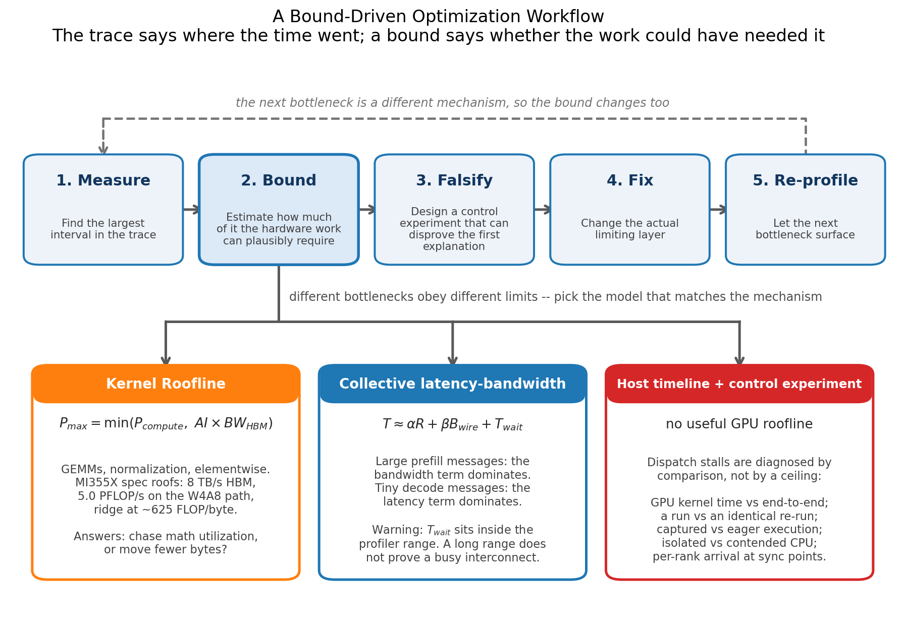

*The Bound step uses three models, each for a different mechanism. The Roofline model applies to kernels, the latency-bandwidth model applies to collectives, and host dispatch stalls require controlled comparisons because they have no useful GPU ceiling. The collective model was critical here because the profiler range includes wait time. A long collective range therefore does not show that the interconnect was busy for the entire interval. After one bottleneck is fixed, re-profiling reveals the next mechanism and the model needed to analyze it.*

The generation script is included with the article: [`make_workflow.py`](/assets/figures/2026-11-02-when-the-trace-blamed-all-reduce/make_workflow.py). The figure is a diagram; the only quantities on it are the MI355X specification roofs quoted above.

---

## Case study 1: the trace blamed all-reduce

### What the trace appeared to say

A TP8 decode trace showed the same pattern. On the slowest-rank critical path, the trace attributed **174 us of a 254 us per-layer interval** to the all-reduce range. This does not mean the links transferred data for 174 us. A blocking collective range also includes time spent waiting for other ranks and any skew created earlier in the step.

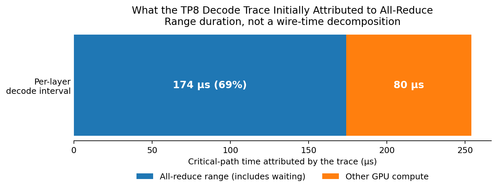

*Initial TP8 decode attribution. The all-reduce segment is the duration of the profiler range, including synchronization wait; it is not a decomposition of wire time. In a clean run, collectives accounted for about 14% of decode kernel time.*

This figure shows the initial hypothesis that the later analysis disproved.

The mismatch was clearer in our first TP8 prefill traces. The collective ranges accounted for roughly half of the profiled step, and the slowest rank spent about twice as long there as the fastest, corresponding to approximately 61% cross-rank imbalance.

Several explanations sounded plausible:

- serial flag polling in the collective;
- loss of the INT4 quantized path at world size eight;
- contention among HBM writers;
- an inefficient XGMI algorithm.

We nearly started rewriting the all-reduce. Before doing that, we estimated the expected transfer time from the payload size and bandwidth.

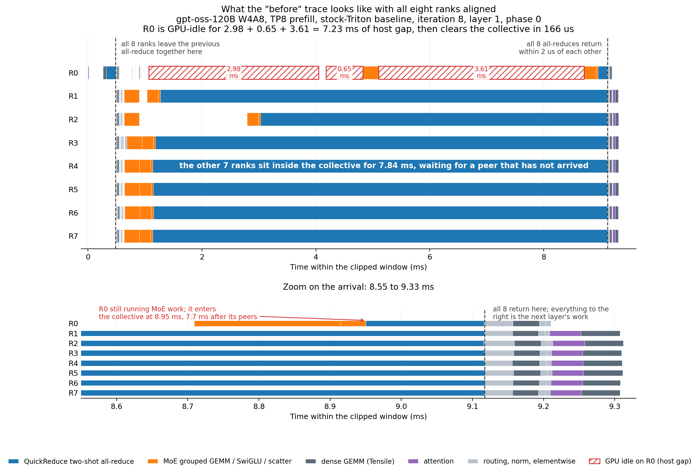

*This eight-rank timeline shows the same all-reduce site as the opening figure. Every bar is a measured GPU kernel from the trace. The dashed lines show that all eight ranks leave the previous all-reduce together at 0.49 ms and return from this one within 2 microseconds of each other at 9.12 ms. Ranks 1 through 7 finish the MoE block by about 1.2 ms and then wait in the collective. Rank 0 is GPU-idle for three intervals—2.98, 0.65, and 3.61 ms, or 7.23 ms total—because its host thread executes work that was not captured in the graph. Rank 0 arrives last and clears the collective in 166 microseconds. The long blue bars include the same transfer plus a wait caused by one rank's host thread.*

*The clip contains only GPU kernels, so host work appears as gaps rather than bars. The 130-160 ms `_fused_add_rmsnorm_pad` stall described later comes from separate CPU-contention runs and does not appear in this window. The annotations show only the gaps measured here.*

The generation script and its input data are included with the article: [`make_before_trace.py`](/assets/figures/2026-11-02-when-the-trace-blamed-all-reduce/make_before_trace.py) and [`iter8_l1p0_gantt.csv`](/assets/figures/2026-11-02-when-the-trace-blamed-all-reduce/iter8_l1p0_gantt.csv), the latter extracted from the eight-rank Perfetto clip `iter8_L1P0_8ranks_strict.json.gz`.

### Bound the transfer component

For a 4096-token prefill chunk, the all-reduce payload is

$$
4096 \times 2880 \times 2\ \text{bytes} \approx 22.5\ \text{MB}.
$$

At TP8, a two-pass all-reduce moves approximately

$$
2\frac{p-1}{p} = 2\frac{7}{8} = 1.75
$$

times the payload, or about 39 MB of estimated wire traffic.

A clean two-pass collective on this system sustained roughly 150-240 GB/s of effective bandwidth. At that rate, the byte-transfer component is approximately

$$
\frac{39\ \text{MB}}{150\text{-}240\ \text{GB/s}} \approx 0.16\text{-}0.26\ \text{ms}.
$$

The profiled cross-rank stagger was 7.81 ms. Even using the conservative end of the bandwidth range, the stagger was about 30 times larger than the transfer component. Startup latency matters, but it does not turn 39 MB into 7.81 ms of link activity on a path that reaches much higher bandwidth in a clean run.

The calculation supports a specific conclusion:

> **For this payload and this execution window, bandwidth could not explain the observed rank spread. The collective was spending most of the interval waiting, not transferring.**

| Quantity | Value |
|---|---:|
| Payload | 22.5 MB |
| Estimated TP8 wire traffic | 39 MB |
| Effective bandwidth in clean runs | 150-240 GB/s |
| Estimated transfer component | 0.16-0.26 ms |
| Observed cross-rank stagger | 7.81 ms |

The calculation showed that optimizing the collective would not address the measured delay.

### Falsify the first explanation

We then ran the same serving command twice, back-to-back, and decomposed each iteration.

The results changed the diagnosis:

- Per-iteration GPU compute repeated within **0.7%**.
- End-to-end throughput changed by about **24%**, from **53.3 to 42.9 requests/s**.
- The slow run contained **130-160 ms host gaps** that affected all eight ranks at once.
- The gaps were centered near `_fused_add_rmsnorm_pad`, not inside a long-running data-transfer kernel.

On a machine without a noisy neighboring workload, the same configuration showed none of the catastrophic stalls. The worst host gap was 2.7 ms and the median was 32 us.

Stable GPU time and unstable wall-clock time indicate that the missing time is outside GPU execution. The per-rank timeline showed how the host delay looked like a communication problem: one rank arrived late at a blocking all-reduce, while the other ranks waited inside the collective range.

### Root cause: incomplete HIP graph coverage plus CPU contention

The serving path used a fixed graph-capture window. Some shapes were captured into a HIP graph, while other shapes fell back to eager, per-kernel dispatch. When a shape took the eager path, the CPU had to submit a longer launch chain. A contended host could interrupt that chain, leaving the GPUs idle.

The blocking collective exposed the arrival-time skew. The profiler attribution was correct—time elapsed inside the all-reduce range—but our first explanation of the cause was wrong.

The fix had two parts:

1. **Use stable AITER paths for the affected operations.** Replacing the unstable Triton paths with AITER kernels reduced execution variation and made graph capture more consistent.
2. **Widen graph capture and compile more serving shapes.** The `widegraph` configuration captured a larger region and reduced eager fallbacks.

We also fixed CPU placement as part of the benchmark configuration.

### What changed after the fix

Over the profiled TP8 prefill window:

- The AITER kernel-path change reduced bottleneck-rank time from **6.11 s to 3.97 s**, a **1.54x** improvement.
- The sample iteration's cross-rank stagger fell from **7.81 ms to 0.017 ms**, about **460x**.
- Wider graph capture reduced the remaining communication-imbalance band from **22.5% to 6-12%**.
- The 130-160 ms host stalls disappeared.
- The best clean `widegraph` run reached **53.3 requests/s at 293 ms mean TTFT**.

The 460x reduction in rank stagger after changing the kernel path and graph capture shows that the original interval was not bandwidth-bound. No interconnect optimization can make a truly bandwidth-limited 39 MB transfer 460 times faster.

The stage ladder below uses **cumulative bottleneck-rank time over the selected profiled window**. It does not decompose collective transfer time or represent an additive end-to-end throughput ablation.

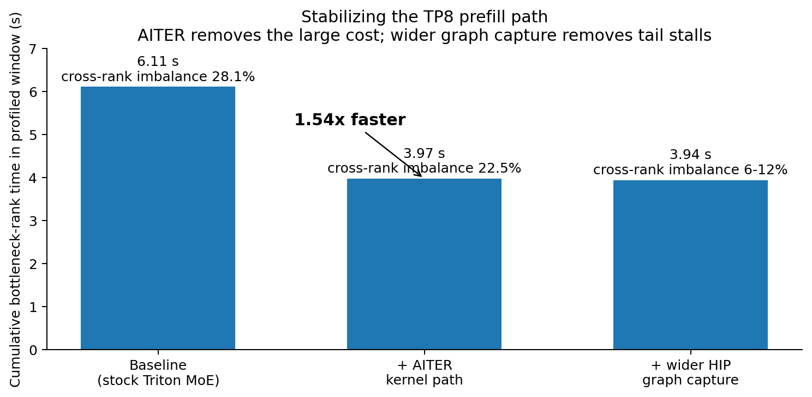

*The AITER kernel-path change produces the large reduction in cumulative bottleneck-rank time, from 6.11 s to 3.97 s. Wider HIP graph capture changes total GPU time only slightly in this window, but removes the catastrophic host-side tail stalls and tightens cross-rank consistency. The percentages are the study's cross-rank imbalance summaries for each stage.*

> [!TIP]
> When a blocking collective dominates a trace, inspect the arrival time of every rank. The slowest rank may be carrying delay created by the host or by an earlier kernel, while the other ranks merely account for that delay inside the barrier.

---

## Case study 2: the real bottleneck was W4A8 MoE

Once the host-side noise was removed, the largest GPU block became clear: the grouped expert GEMMs in the W4A8 MoE path.

We then used a conventional compute/HBM Roofline to analyze the kernel.

### One kernel, two operating regimes

The figure below combines **measured tuned-kernel times** with **modelled arithmetic intensity**. The y-axis comes from the best measured `best_us` value for each TensorAtlas W4A8 MoE-GEMM shape. The x-axis is calculated by the supplied script rather than measured from HBM counters.

The current model makes the following assumptions:

- `M` is the number of pre-routing tokens in the step;
- top-4 routing produces `assignments = M x 4` token-expert pairs;
- `active_experts = min(128, assignments)`, an upper-bound distinct-expert assumption;
- each active expert's MXFP4 weights are loaded once at `0.5 + 1/32` bytes per element, including E8M0 scale metadata;
- FP8 activations cost 1 byte per element and BF16 outputs cost 2 bytes per element;
- routing metadata, temporary buffers, padding traffic, and cache effects are not included.

The plot is a **specification Roofline with measured kernel points**; it does not measure HBM traffic directly. At low `M`, routing collisions could activate fewer experts than the upper-bound model assumes, shifting the point to the right. The decode conclusion still holds because the point remains far below the 625 FLOP/byte specification ridge, but the exact arithmetic-intensity value is not a hardware-counter measurement.

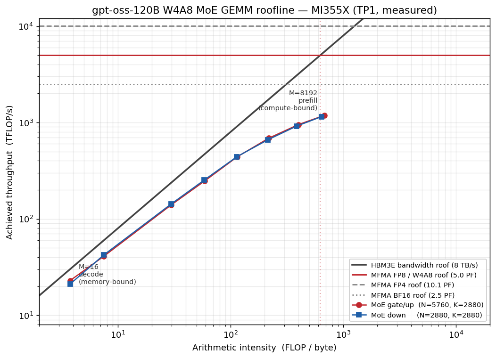

*W4A8 MoE GEMM Roofline for the full-model TP1 gate/up and down shapes. The sloped 8 TB/s line and horizontal 5.0 PFLOP/s line are MI355X specification roofs; the red and blue points use measured tuned AITER kernel times. The gray FP4 and BF16 lines are context only. The x-axis follows the byte model described above.*

The generation script is included with the article: [`make_roofline.py`](/assets/figures/2026-11-02-when-the-trace-blamed-all-reduce/make_roofline.py).

At **M = 16**, representative of decode under the current model:

- Arithmetic intensity was approximately **3.8 FLOP/byte**.
- Measured throughput was **22.9 TFLOP/s**.
- The kernel reached about **76% of the 8 TB/s specification memory Roofline**.

Because the result is close to the bandwidth roof, faster arithmetic alone cannot create a large gain. Decode optimization should focus on reducing bytes, improving memory access, avoiding padding, and removing latency around the GEMM.

At **M = 8192**, representative of prefill:

- Modelled arithmetic intensity rose to approximately **680 FLOP/byte**.
- In this model, the point sits just beyond the 625 FLOP/byte specification ridge.
- Measured throughput was **1.19 PFLOP/s**, about **24% of the 5.0 PFLOP/s specification compute roof**.

This does not prove that every production prefill shape is unambiguously compute-bound: routing balance, padding, metadata, and TP-specific short-K shapes can move the operating point. It does show that the large-M TP1 kernel sweep has substantially more compute headroom than the decode regime. Tile shape, pipeline stages, occupancy, scale handling, and short-K behavior are therefore worth tuning.

### Optimization 1: tune grouped GEMM by serving shape

The original dispatch did not consistently select efficient tile sizes and pipeline stages for the gpt-oss expert shapes on gfx950. We added per-shape configurations and hardened the fallback path in AITER.

Selecting a kernel requires more information than the model's use of W4A8 MoE. The hot shapes change with:

- token count and expert load;
- tensor-parallel degree;
- padded versus logical N and K;
- up/gate versus down projection;
- decode versus prefill.

The AITER changes added tuned `(block_m, N, K)` entries for the relevant gfx950 shapes and improved fallback selection so an untuned shape did not silently borrow a configuration that was unsafe or inefficient for CDNA4 scale handling.

### Optimization 2: fix output allocation before measuring speed

The same AITER work also fixed a correctness issue. The kernel allocated output storage using the logical, unpadded N while computing tiles over padded N. When `block_n` did not divide the logical dimension, the last tile could write beyond the allocated buffer.

The fix sizes the output buffer to padded N while preserving the logical output shape presented to the caller.

Correctness constrains performance tuning: a kernel configuration is not a valid optimization if it relies on undefined memory behavior. We do not count the allocation fix as an isolated performance gain.

### Optimization 3: gate MX-scale swizzling by tensor parallelism

CDNA4 can use a swizzled MX-scale layout that is efficient for some shapes. Swizzling, however, imposes block-size and padding constraints. Tensor parallelism shrinks the per-GPU contraction dimension:

- **TP4:** K = 720
- **TP8:** K = 360

At those short K values, padding to the block size required by the swizzled path can cost more than the layout saves. After retuning both paths, the plain strided layout won **23 of 28** TP4/TP8 benchmark cells and improved selected decode-heavy 1K/1K cells by as much as **19%**. The swizzled path remained useful for TP1/TP2 and in a small high-concurrency prefill corner.

The vLLM gate therefore selects:

- swizzle **on** for TP1 and TP2;
- strided layout for TP4 and TP8.

Both the weight-load layout and kernel argument use the same `should_use_cdna4_mx_scale_swizzle()` helper. Centralizing the decision is important because a mismatch can silently corrupt the scale tensor.

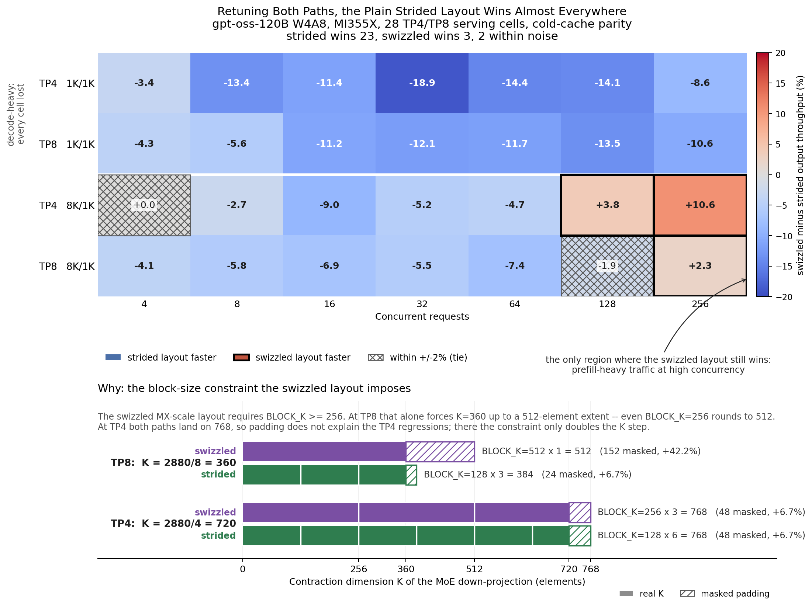

*Each cell is a measured A/B test between the two retuned layouts. Tests used the same container image, with the vLLM torch-compile, Triton, and inductor caches purged before each cell. Treating results within 2% as ties, the strided layout wins 23 cells, the swizzled layout wins 3, and 2 are ties. Swizzling trails in all 14 decode-heavy 1K/1K cells, by as much as 18.9%. It retains an advantage only for prefill-heavy 8K/1K traffic at 128 and 256 concurrent requests.*

*The lower panel derives the mechanism from the two tuned dispatch JSONs. Both paths were retuned before the comparison, so this is a layout A/B at matched tuning quality, not a tuned-versus-untuned artefact. The swizzled MX-scale layout makes scale loads more efficient but requires `BLOCK_K` of at least 256. For the decode down-projection, which contracts over K = 2880/TP, that constraint is expensive: at TP8, K = 360, and the tuned swizzled entry steps a 512-element extent against the strided entry's 384, so 152 elements of every pass are masked against 24. Masked elements are work the GPU performs and discards, and here that discarded compute outweighs the scale-load saving. At TP4 both paths land on 768 and mask the same 48 elements; there the layouts differ only in the K step, 256 against 128. The gate follows the measurement: strided at TP4 and TP8, swizzled at TP1 and TP2, where it wins.*

The generation script and its input data are included with the article: [`make_swizzle_gate.py`](/assets/figures/2026-11-02-when-the-trace-blamed-all-reduce/make_swizzle_gate.py) and [`swizzle_ab_28cell.csv`](/assets/figures/2026-11-02-when-the-trace-blamed-all-reduce/swizzle_ab_28cell.csv).

---

## Why TP8 did not automatically beat TP4

Doubling the GPU count does not guarantee a 2x speedup. Tensor parallelism changes both the communication pattern and the kernel shapes.

### The expert GEMM gets shorter

Moving from TP4 to TP8 reduces the expert GEMM contraction dimension from K=720 to K=360. Short-K GEMMs provide less work per launch and can use matrix hardware less efficiently. In our profile, the expert GEMMs reached only about **61% strong-scaling efficiency** from TP4 to TP8.

### The router GEMM is replicated

The router projection is mathematically

$$
[M, 2880] \times [2880, 128].
$$

It is replicated on every GPU rather than sharded. Under the profiled TP8 path, it moved to a two-pass split-K implementation and increased from roughly **200 us to 411 us**. More GPUs did not reduce that work.

### The collective has another synchronization stage

TP4 used a single-stage custom all-reduce, while TP8 used a two-stage path. For 5.6-23 KB decode messages, startup and synchronization dominate link-transfer time. Adding a second stage adds a fixed cost to each of roughly 73 collectives per token step.

### The MoE block lost time overall

In the representative trace, the MoE block increased from **4,363 us at TP4 to 4,466 us at TP8**, about 2.4% slower. Approximately 427 us of GEMM compute savings were offset by additional collective, router, and buffer-fill costs.

The net TP8 improvement in that profile came from attention, not from the MoE block. End to end, this produced a workload-dependent crossover:

- TP4 was often better for prefill-heavy and low-concurrency traffic.
- TP8 became better at sufficiently high concurrency.

There is no universal best tensor-parallel degree. It is a serving-policy choice tied to the request distribution and latency objective.

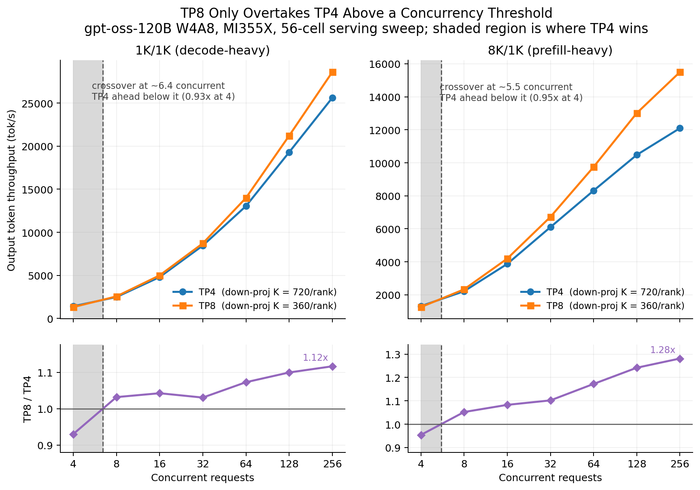

*TP4 versus TP8 across the concurrency ladder in the same 56-cell sweep. At concurrency 4, TP8 trails on both shapes: 0.93x on 1K/1K and 0.95x on 8K/1K. It crosses over between concurrency 4 and 8, then reaches 1.12x on 1K/1K and 1.28x on 8K/1K at concurrency 256. These figures show aggregate throughput at a fixed GPU count per line, not per-GPU efficiency. After per-GPU normalization, TP4 leads at every sampled point. The annotated K is the MoE down-projection contraction depth per rank, 2880/TP.*

The generation script and its input data are included with the article: [`make_tp_crossover.py`](/assets/figures/2026-11-02-when-the-trace-blamed-all-reduce/make_tp_crossover.py) and [`serving_sweep_56cell.csv`](/assets/figures/2026-11-02-when-the-trace-blamed-all-reduce/serving_sweep_56cell.csv).

---

## What changed in vLLM and AITER

The gains came from multiple layers working together.

| Layer | Change | Purpose |
|---|---|---|
| vLLM runtime | Wider HIP graph capture and more compiled serving shapes | Reduce eager fallback and host launch gaps |
| vLLM dispatch | TP-aware CDNA4 MX-scale swizzle gate | Avoid padding overhead at TP4/TP8 and keep layout decisions consistent |
| AITER kernel path | Stable replacements for affected Triton operations | Reduce variation and improve captured execution |
| AITER grouped GEMM | Per-shape gfx950 W4A8 tuning and hardened fallback | Improve hot expert GEMM shapes and avoid unsafe configuration reuse |
| AITER correctness | Allocate W4A8 MoE output for padded N | Prevent out-of-bounds writes on tail tiles |
| Benchmark operations | CPU isolation/pinning and repeated runs | Separate host noise from GPU execution |

The upstream changes include:

- [AITER PR #3428: W4A8 tuned dispatch, safe fallback, and padded-N output allocation](https://github.com/ROCm/aiter/pull/3428)
- [AITER PR #3580: additional gpt-oss shapes and fallback hardening](https://github.com/ROCm/aiter/pull/3580)
- [vLLM PR #44804: hybrid CDNA4 swizzle gate](https://github.com/vllm-project/vllm/pull/44804)

### Ablation: match each fix to its metric

The optimizations interact, so their gains should not be added. Each change is evaluated with its most relevant metric.

| Stage | Evidence | Observed effect |
|---|---|---|
| Baseline trace | TP8 prefill | 6.11 s bottleneck-rank time; 7.81 ms sample rank stagger; catastrophic host gaps in noisy runs |
| Stable AITER path | Same profiled window | 3.97 s bottleneck-rank time; 0.017 ms sample rank stagger |
| Wider graph capture | Repeated TP8 runs | Residual imbalance reduced to 6-12%; 130-160 ms stalls removed |
| Grouped-GEMM tuning | Kernel dispatch and hot shapes | Better gfx950 tile/stage choices; quantifying the standalone full-sweep contribution requires raw ablation data |
| Swizzle gate | 28 TP4/TP8 cells | Strided layout won 23 cells; up to 19% on selected 1K/1K cells |
| Full stack | 56-cell serving sweep | 1.63x decode-heavy geomean; 1.53x prefill-heavy geomean; up to 2.3-2.4x on individual cells |

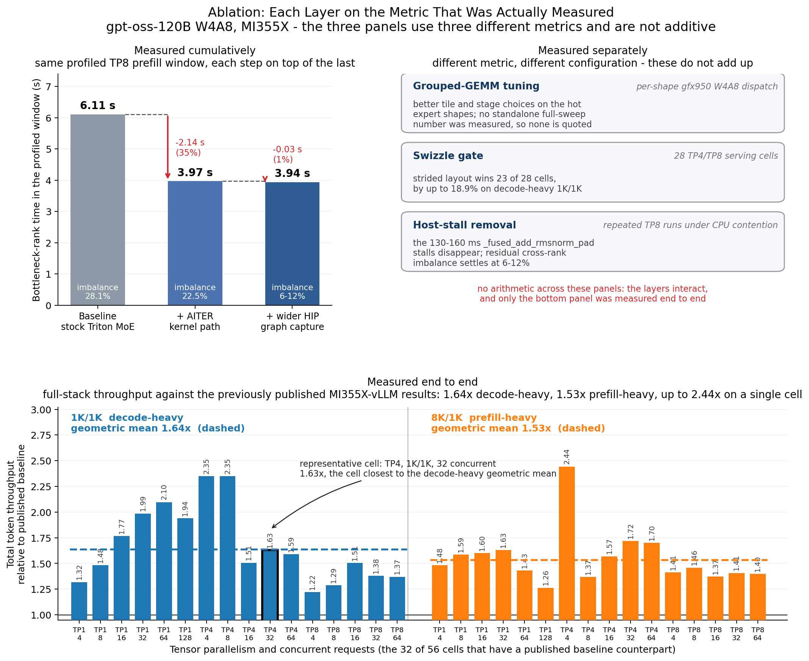

*The panels use three different metrics; do not multiply or add their values. **Left:** cumulative bottleneck-rank time in the same profiled TP8 prefill window, with each step applied after the previous one. **Right:** changes measured independently in their own configurations. Cards distinguish these results from the cumulative bars. **Bottom:** the only end-to-end measurement, comparing total token throughput with the previously published MI355X-vLLM results for the 32 of 56 sweep cells that have a published counterpart. The outlined bar marks the cell closest to the decode-heavy geometric mean. No single cell was measured as a per-stage serving-throughput ladder, so the left panel reports profiled-window time rather than tokens per second.*

The generation script and its input data are included with the article: [`make_ablation.py`](/assets/figures/2026-11-02-when-the-trace-blamed-all-reduce/make_ablation.py) and [`ablation_fullsweep.csv`](/assets/figures/2026-11-02-when-the-trace-blamed-all-reduce/ablation_fullsweep.csv).

---

## End-to-end results

We evaluated TP1, TP2, TP4, and TP8 over concurrency 4-256 for two request shapes, producing 56 matched cells. Every run started from a cold cache with matched input and output lengths.

Against the previously published MI355X-vLLM results on the same serving harness, the optimized stack delivered:

- **1.63x geometric-mean throughput improvement** on decode-heavy 1K/1K traffic;
- **1.53x geometric-mean throughput improvement** on prefill-heavy 8K/1K traffic;
- **2.3-2.4x** on the best individual cells.

These are full-stack results. They combine more complete graph capture, stable AITER paths, grouped-GEMM tuning, correctness hardening, and TP-aware layout selection.

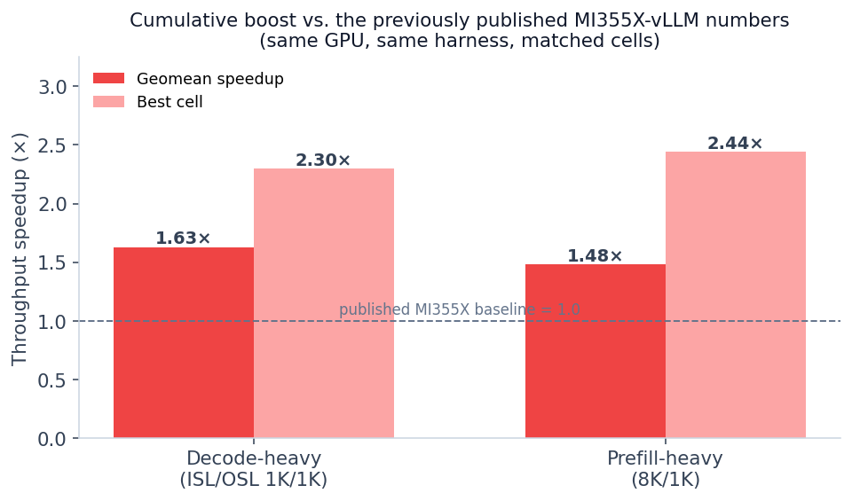

*Final full-stack speedup over the previously published MI355X-vLLM snapshot on matched cells. Dark bars show the geometric mean across cells; light bars show the best individual cell. This chart summarizes the outcome of the complete stack and does not attribute the gain to individual changes.*


### Accuracy

Under the same evaluation configuration, the optimized serving path showed no accuracy regression relative to the unoptimized path.

We publish the evaluation manifest instead of only a headline score. Reproducing a GSM8K result requires the evaluator, metric definition, decoding parameters, and sample count:

| Item | Value |
|---|---|
| Harness | `lm-evaluation-harness` 0.4.9.2 |
| Task | `gsm8k`, task version 3.0, 5-shot, 1319 of 1319 samples |
| Interface | `local-chat-completions` against the served OpenAI-compatible endpoint |
| Decoding | `temperature=0`, `top_p=1`, `max_tokens=1152` |
| Metrics | `exact_match` reported under both `strict-match` and `flexible-extract` |

A representative run on the optimized path scores **0.961 strict-match** and **0.961 flexible-extract**, each with a standard error of 0.005. Across repeated runs, scores range from 0.951 to 0.965. Because that spread is comparable to the standard error, we treat differences within the range as run-to-run noise.

The two metrics agree within 0.001 here. For models that answer in prose, however, `strict-match` can fall sharply while `flexible-extract` remains high. A GSM8K score is therefore ambiguous unless its filter is specified.

We do not use this score as a headline result. It is a regression guard on the serving-path changes, not a claim about the model's reasoning quality.

---

## What generalizes, and what does not

| General method | Case-specific detail |
|---|---|
| Check profiler attribution against a physical bound | 8 TB/s HBM and 5 PFLOP/s W4A8 roof on MI355X |
| Use an alpha-beta model for collectives | QuickReduce thresholds and TP8 two-stage behavior |
| Compare GPU time with end-to-end time | `_fused_add_rmsnorm_pad` and this graph-capture window |
| Repeat identical runs under controlled CPU placement | The particular noisy-neighbor event in this system |
| Re-profile after every major fix | The exact sequence: communication -> graph capture -> AITER -> MoE GEMM -> swizzle |
| Treat prefill and decode as different operating regimes | gpt-oss top-4, 128-expert W4A8 shapes |
| Re-evaluate kernel layouts when TP changes shape | K=720 at TP4 and K=360 at TP8 |
| Separate correctness fixes from performance claims | The padded-N output allocation bug |

---

## Serving recipe

The following command reproduces the optimized serving path used for these measurements. Because nightly images change, pin the image digest and source commit SHAs when publishing results.

```bash
# vLLM 0.23.1-dev + AITER 0.1.16 + Triton 3.6.0 used for these measurements
IMAGE=vllm/vllm-openai-rocm:nightly-34b560b725b401f33477464163244b4744d1c40f
MODEL=amd/gpt-oss-120b-w-mxfp4-a-fp8

export VLLM_ROCM_USE_AITER=1
export VLLM_ROCM_USE_AITER_TRITON_ROPE=1
export VLLM_ROCM_QUICK_REDUCE_QUANTIZATION=INT4
export AMDGCN_USE_BUFFER_OPS=0

vllm serve "$MODEL" \
  --tensor-parallel-size 8 \
  --attention-backend ROCM_AITER_UNIFIED_ATTN \
  --compilation-config '{"pass_config": {"fuse_rope_kvcache": true}}' \
  --block-size 64 \
  --gpu-memory-utilization 0.95 \
  --no-enable-prefix-caching \
  --reasoning-parser openai_gptoss
```

`--reasoning-parser openai_gptoss` is required for the vLLM 0.23.x configuration used here. Without the appropriate gpt-oss parser, Harmony-channel output may not appear in the expected chat-completions content field, invalidating an accuracy test.

The TP-aware CDNA4 MX-scale layout decision is internal. No user flag is required: TP1/TP2 select the swizzled path, while TP4/TP8 select the strided path.

`VLLM_ROCM_QUICK_REDUCE_QUANTIZATION=INT4` enables the quantized collective path only when its dispatch conditions are met. It does not reduce every payload. In the profiled 4096-token TP8 prefill case, the threshold condition did not select the INT4 path.

---

## Remaining work

### Improve short-K MoE scaling

The TP4-to-TP8 step reduces K from 720 to 360 and reaches only about 61% strong-scaling efficiency for the expert GEMMs. The next kernel work should target:

- tile shapes designed for K=360;
- less padding;
- pipeline choices for short K;
- better MFMA utilization;
- routing-aware tuning for small per-expert token counts.

### Overlap communication with computation

After the host stalls were removed, decode collectives still accounted for about 14% of kernel time in a clean run and remained on the critical path. One option is to replace fully blocking reductions with reduce-scatter/all-gather patterns and sequence-parallel execution. This would let the next local normalization or projection begin before communication completes.

### Test more production-like traffic

The sweep used fixed request shapes. Mixed context lengths, prefix-cache hits, multi-turn traffic, and bursty arrivals can change graph coverage, expert load balance, and the TP4/TP8 crossover. Repeat this workflow instead of assuming that the same configuration remains optimal.

---

## Conclusion

The first trace told a convincing story: all-reduce appeared to dominate, so communication looked like the bottleneck. A simple bound showed that the bytes could not account for the observed delay. A control experiment then located the missing time on the host. Fixing HIP graph coverage and unstable execution paths removed the false bottleneck and exposed the real one: W4A8 grouped MoE GEMMs that were memory-bound in decode and below the compute roof in prefill.

The sequence matters more than any single kernel change.

- **Profiler ranges tell us where time was attributed.**
- **Performance bounds tell us whether that attribution can explain the runtime.**
- **Controlled experiments establish the cause.**
- **Re-profiling reveals the next bottleneck.**

The combined vLLM and AITER changes improved the MI355X serving sweep by 1.63x geometric mean on decode-heavy traffic and 1.53x on prefill-heavy traffic, with all changes upstreamed or represented by upstream work. More importantly, the investigation produced a reusable method for the next model, the next kernel, and the next accelerator:

> **Measure. Bound. Falsify. Fix. Re-profile.**

---

## Appendix A: Dated cross-platform snapshot

For context only, we place the optimized MI355X results beside dated B200 vLLM and TensorRT-LLM snapshots of the same model. These are not matched runs: the snapshots were collected separately, on different hardware, under an older software stack, as the versions below show. Read them as a dated reference point rather than a controlled comparison.

On decode-heavy 1K/1K traffic, the reported peak per-GPU throughputs were:

- MI355X: **36.5k token/s/GPU**
- B200 with vLLM: **18.3k token/s/GPU**
- B200 with TensorRT-LLM: **28.0k token/s/GPU**

On prefill-heavy 8K/1K traffic:

- MI355X: **50.1k token/s/GPU**
- B200 with vLLM: **51.5k token/s/GPU**
- MI355X was **0.81x** the reported B200 TensorRT-LLM result.

These numbers come from the [InferenceX dashboard](https://inferencex.semianalysis.com/) configurations `gptoss-fp4-mi355x-vllm`, `gptoss-fp4-b200-vllm`, and `gptoss-fp4-b200-trt`. They used vLLM 0.22.0 and TensorRT-LLM 1.3.0rc14 and were last published on 2026-07-06.

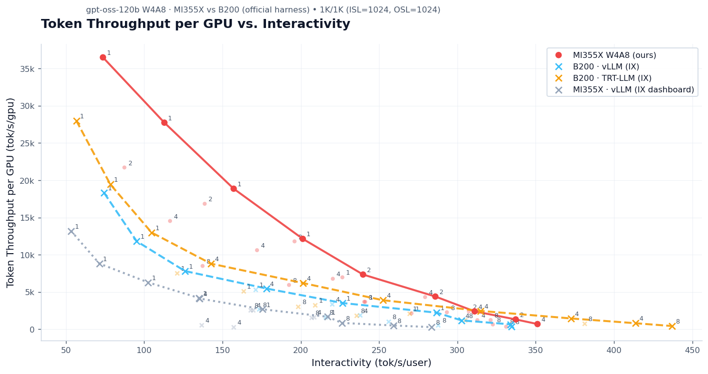

*Decode-heavy 1K/1K snapshot. The connected lines show the reported nondominated frontier; faint points show the remaining measured cells. The small numerals identify tensor-parallel degree. Interactivity is expressed as tokens/s/user, derived from median TPOT. Per-GPU normalization is useful for this plot but is not a complete node-cost comparison.*

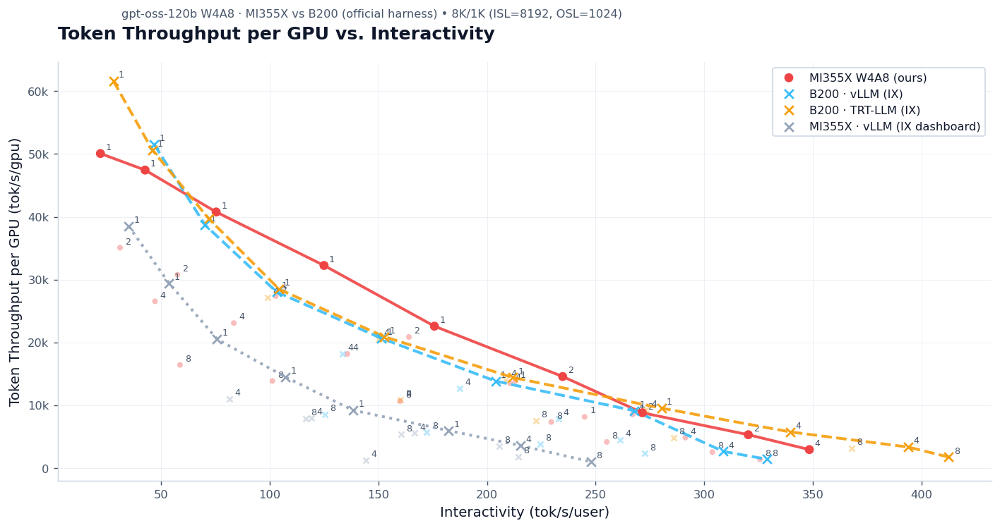

*Prefill-heavy 8K/1K snapshot, shown with the same conventions. These figures belong in the appendix because their interpretation depends on the exact collection date, framework versions, host setup, TP degree, and benchmark harness.*

---

## Acknowledgements

We would like to thank everyone who contributed to this collaboration,
including Xiaohu Guo, Chang Liu, Chun Fan, Rohan Potdar, Lixun Zhang, Peng Sun, and Andy
Luo.

## Resources

- [vLLM](https://github.com/vllm-project/vllm)
- [AMD AITER](https://github.com/ROCm/aiter)
- [Roofline figure generator](/assets/figures/2026-11-02-when-the-trace-blamed-all-reduce/make_roofline.py)
- [InferenceX dashboard](https://inferencex.semianalysis.com/) (source of the cross-platform snapshot in Appendix A)
- [AMD Instinct MI355X specifications](https://www.amd.com/en/products/accelerators/instinct/mi350/mi355x.html)
- [AMD W4A8 gpt-oss-120b checkpoint](https://huggingface.co/amd/gpt-oss-120b-w-mxfp4-a-fp8)
- [OpenAI gpt-oss model overview](https://openai.com/index/introducing-gpt-oss/)
- [AITER PR #3428](https://github.com/ROCm/aiter/pull/3428)
- [AITER PR #3580](https://github.com/ROCm/aiter/pull/3580)
- [vLLM PR #44804](https://github.com/vllm-project/vllm/pull/44804)

## Benchmark disclaimer

Measurements were run on an AMD Instinct™ MI355X platform using the configuration below.

**Hardware configuration**

8× AMD Instinct™ MI355X GPUs (gfx950) with 2× AMD EPYC™ 9575F 64-Core processors.

**Software configuration**

Ubuntu 22.04.5 LTS, ROCm/HIP runtime 7.2.53211, vLLM 0.23.1rc1.dev1120+g0f0f28b53, PyTorch 2.11.0+gitd0c8b1f, Transformers 5.13.1, Python 3.12.13, AITER 0.1.16, Triton 3.6.0.

Results apply to the hardware, software, model, request shapes, tensor-parallel degrees, and measurement procedures described here. Differences in server configuration, firmware, framework and vLLM versions, kernel selection, clocks, drivers, optimizations, or concurrent system activity can materially change performance. Cross-platform numbers are dated snapshots and should not be generalized beyond the matched cells and software versions disclosed with the final dataset.
